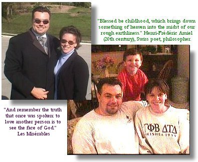

*Originally posted to jays.net (blosxom) on 2001-12-22.*

Welcome to jays.net v3.0. ([jays.net v2.0](http://jays.net/archives/2000/retired2/oldindex.html)) I made my soon-to-be-outdated Xmas logo on the right w/ Paint Shop Pro 6.

Woke up this morning to the first sleet/snow of the year (1 inch?). Nope. I haven't gotten hardly any Xmas shopping done yet. Doh!

### Q4 2001 Nutshell

Andria and I saw Les Miserables at the Orpheum theatre in Omaha. Wow. Randal Keith's (*Jean Valjean*) performance of "Bring Him Home" was by far the most powerful piece of performance art I've ever witnessed. Simply unreal.

On a much smaller fiscal scale, I had yet another blast running lights (etc.) for Shelterskelter 6 (my 3rd!). You can keep up with my theatre junk on [my thespianism page](http://jays.net/archives/2002/theatre/).

My friend Josh now hosts jays.net since Cox firewalled port 80 at the jays.net NOC. He da man.

### 2001 Nutshell

As of 11/26/2001 I've had a girlfriend for over a year *and she's still speaking to me!* Somebody make a call -- I've set a new record. Well, Andria should probably receive the fame and glory since she's the one doing the hard work putting up with me. -grin-

 For those who haven't met them, Andria and Zachery Desmet are on the left. Andria wants you to know that the photo on the right is terrible and was taken after we had been driving for 6 hours (back from Frank Delin's wedding). I think the disclaimer is unnecessary, but I'm writing this without my contacts in. And I'm a guy, which genetically cripples my sense of aesthetics. Zach and Andria turn 5 and 26ish next year, respectively.

In case you didn't know, I'm a very lucky man.

As further proof of my general good fortune, I'm now in year 3 of working for Omni Hotels as Application Development Manager. [Our department](http://jays.net/archives/2001/omni/) accomplishes some pretty amazing things. I'd detail out some nuts and bolts for you, but I do that all day at work. Swing by for a meeting or two and I'll bore ya to tears. -grin-
