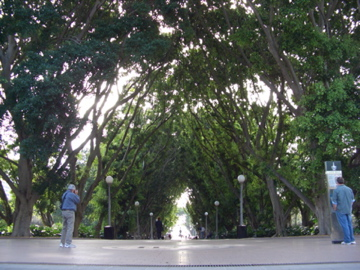
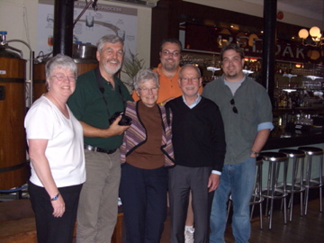
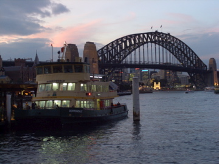

*Originally posted to jays.net (blosxom) on 2007-06-06.*

|  |  |
|----|----|
|  | We wandered north through Hyde Park. Unbelievable arch of trees, a "possum" sleeping in one of them like no possum in the US, a beautiful fountain and church, and a giant chess board. |

|  |  |
|----|----|
| Met up with Harlan and Lyn Hall at the Red Oak tavern. Ate lunch and exchanges stories, observations, and comparisons. Lovely people. On Friday they're on their way to Europe for a sailing and Ireland walkabout adventure. |  |

<table>
<colgroup>
<col style="width: 50%" />
<col style="width: 50%" />
</colgroup>
<tbody>
<tr>
<td>We went to the top of the Sydney Tower to see the lay of the land in all directions. Mailed postcards from the highest working post office in the southern hemisphere. Brad and I were startled by how much higher the Teipei 101 felt in the summer of 2005.

Towards dusk we took the subway to and from Circular Quay (pronounced "key"). Saw enormous bats, more "possums" some of which let Brad get right up to them. Wandered to the Sydney Opera House (quite a site at night) and back home for more sleep.
</td>
<td></td>
</tr>
</tbody>
</table>
