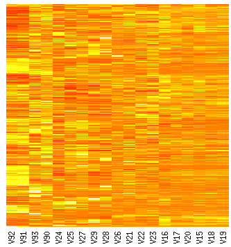

*Originally posted to [headrattle](https://headrattle.blogspot.com/2008/02/data-diving-for-diseases.html) on 2008-02-19.*

If you squint you may see breast cancer hiding in this picture. If you spot it please send me an email. In the meantime, we'll keep kicking out these [heat map](http://en.wikipedia.org/wiki/Heat_map)s of [gene expression](http://en.wikipedia.org/wiki/Expression_profiling) data from [microarray](http://en.wikipedia.org/wiki/DNA_microarray)s.
