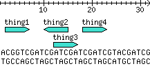

*Originally posted to [headrattle](https://headrattle.blogspot.com/2008/05/glyphdna-kiva-props.html) on 2008-05-14.*

My [jays.net](http://jays.net/) ISP went "poof," so I made an ungraceful migration to [a new one](http://www.maiahost.com/cms/MediaWiki_Hosting.html). Between that and my lappie hard drive dying it's been a tough month in the personal computing front. :)  
  
 I added [how to add a DNA track](http://www.bioperl.org/wiki/HOWTO_Discussion:Graphics) to the BioPerl wiki. BioPerl is so cool. :)  
  
It's been a month since we made our first loans on Kiva.com, and now our first round of re-payments have arrived! mwoohahaha! Oh, and did you know about [Kivafriends](http://kivafriends.org) and [Kivapedia](http://kivapedia.org/)?
