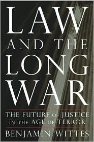

*Originally posted to [headrattle](https://headrattle.blogspot.com/2008/09/law-and-long-war.html) on 2008-09-17.*

A great book I'm reading: [Law and the Long War: The Future of Justice in the Age of Terror](http://www.amazon.com/Law-Long-War-Future-Justice/dp/159420179X). His excellent intro lays out the gulf between the two major opposing perspectives on the Bush administration's actions, and argues for middle ground. So far I'm on the human rights side of the argument and not in the middle ground at all, but I just started the book, so maybe he'll convince me.  
  
Maybe [Erin and Pete](http://jays.net/pipermail/spam2_jays.net/2008-September/000058.html) can find some middle ground too? :)
