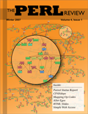

*Originally posted to [headrattle](https://headrattle.blogspot.com/2008/02/only-perl-can-parse-perl.html) on 2008-02-19.*

  
I got thrown into yet another new-to-me ball of Perl today and thought it would be really cool if I could kick out a [GraphViz](http://www.graphviz.org/) graph of all the subroutine calls, like Alan Ferrency attempted back in 2000: [sub_graph.pl](http://www.perlmonks.org/?node_id=25807). Looks like nobody has really pulled this off and sent it to CPAN? \#perl-help sent me to [PPI](http://search.cpan.org/%7Eadamk/PPI-1.201/lib/PPI.pm) which cites [Randal's famous line](http://www.perlmonks.org/index.pl?node_id=44722): "the only thing that can parse Perl is perl"!  
  
Bummer... If only I had unlimited free time I could probably get close-enough? I'll email Alan and see if it's moved since 2000. :)  
  
Eric Maki inspired me in Issue 4.1 (Winter 2007) of [The Perl Review](http://theperlreview.com/). But his is Perl op codes, not Perl 5 subroutine calls... -ponder-

## Comments

**brian d foy** — February 20, 2008 at 4:45 PM

A graph of subroutine *calls* is easy because you just run the program and look like I did in [Creating Perl Code Graphs](http://www.ddj.com/architect/184404560), although you'd probably want to plug in a different DProf.  
  
Figuring out what it will do beforehand is a bit of a problem though since it probably depends on the input.  
  
Good luck, and I'm glad you liked the article :)

