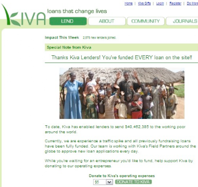

*Originally posted to [headrattle](https://headrattle.blogspot.com/2008/08/run-on-bank-in-reverse.html) on 2008-08-31.*

I got an email from [Kiva](http://kiva.org) today saying that they've made a systems change so that I get Kiva credit back not when a loan has been fully repaid, but every time Kiva receives partial payment back from the field partner. So, suddenly I had a bunch of Kiva credit I wasn't expecting until next year.  
  
Cool! So I hopped out to kiva.org to grab me some more loans, to find that only 3 loans were available to fund. Usually there are hundreds. And those 3 were actually funded already (Kiva is a little laggy about updating loan statuses). So apparently this systems change has suddenly freed up hundreds of thousands of dollars in donor's money, causing a flood of new loan purchases, to the point where they've run out of people to loan money to!  
  
As [Jane Sladen said](http://www.kivafriends.org/index.php/topic,985.msg41819.html#msg41819): "kind of like trying to buy Elton John tickets on line - click before they're gone!!"  
  
So here I am with Kiva credit and nobody to loan money to. What a terrific problem to have! This bump is a little weird but I'm sure after a few days the newly improved cash flow of donors will enable Kiva to give more loans, faster overall.  
  
(Hopefully nobody decides to pull their money out instead of waiting patiently for loan opportunities. I'm sure Kiva will soon catch up with the total capacity of their donor pool.)  
  

