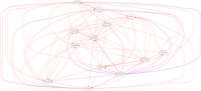

*Originally posted to [headrattle](https://headrattle.blogspot.com/2009/09/graphviz-prettyness.html) on 2009-09-13.*

  
My first mapping of bioinformatics alignment score to how dark a GraphViz line should appear, and switching colors based on other criteria... Perl++ GraphViz++  
  
I don't think it's very informative, but there's no denying it's pretty. :)
