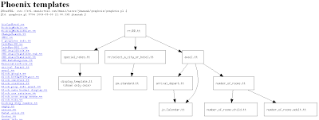
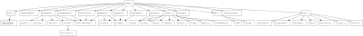

*Originally posted to [headrattle](https://headrattle.blogspot.com/2009/05/perl-template-toolkit-and-graphviz.html) on 2009-05-18.*

Our largest [Catalyst](http://www.catalystframework.org/) application ([ssl.omnihotels.com](https://ssl.omnihotels.com)) is composed of 184 templates. I get lost sometimes while template diving, and forget the parent node(s) of my current node.  
  
Inspired by [The Perl Review](http://www.theperlreview.com/Issues/subscribers.html) Issue 4.1, I decided to give GraphViz a stab. To my surprise, I got it working very quickly. I wrote a quick CGI hack that lets me click on any of my templates from a list on the left, and it draws an INCLUDE diagram of all downstream templates for me. Here's a screen shot of the CGI in action:  
  
Pretty slick, huh? Here's what it drew for our `wrapper.tt`, which is the parent of many of our templates:  
  
You could throw the same crude implementation at any tree, really. I think I'll try all the `use` statements in our in-house perl code base next. :)  
  
The source code is [here](https://github.com/jhannah/sandbox/tree/main/graphviz). Enjoy!
