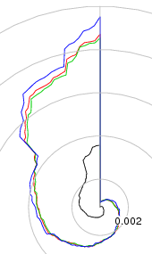

*Originally posted to [headrattle](https://headrattle.blogspot.com/2009/04/swirly-bacteria.html) on 2009-04-27.*

Spent yesterday drawing pretty pictures of bacterial genomes with Perl, BioPerl, and R. Given the genetic sequence of different bugs (ACCTGTCGATGCTA...) we're looking for fingerprints in the composition of those sequences. Pick out the 200 most frequest 5-letter "words" (oligos), sort and plot those, and maybe we can see the fingerprint of each bug.  
  
It seems to work. The black line is E. coli., which is very different from Staph. aur. (red and green) and Staph. epi. (blue). You'll also notice that the 2 Staph aur. lines are very close to each other, since they're almost identical; they're very similar to yet distinct from Staph. epi; and distant from E. coli.  
  
Cool, huh? [The details](https://rtg.ist.unomaha.edu/Ticket/Display.html?id=467) (username: guest, password: guest)

## Comments

**BrotherBemused** — May 1, 2009 at 4:54 AM

Very artsy! Looks like a musical note to me. (And reminds me of my latest money-maker idea: take the drop cloth that Habitat uses on paint projects, cut it into sections, frame the sections, and sell them as a For Real/Abstract Art Benefit for Habitat. I'm thinking that between the conversation-starter value and the real-deal approach to philanthropy, these babies would leap off the galley walls!)

