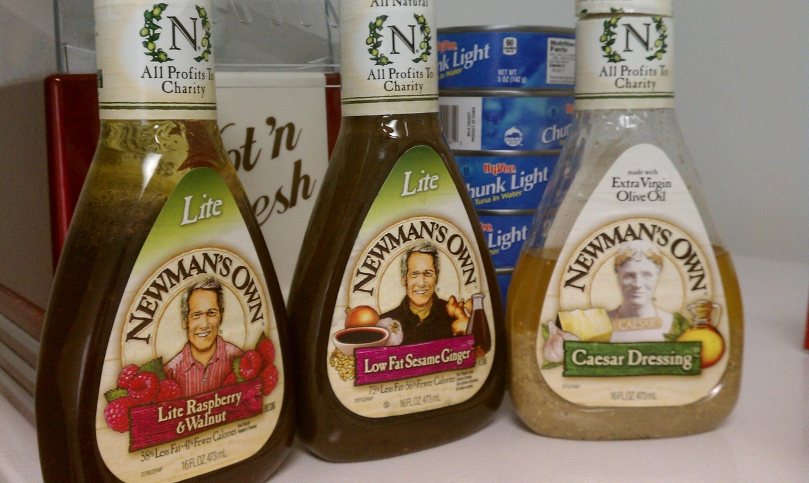

*Originally posted to [deafferret](https://deafferret.tumblr.com/post/32883515345/day-17-of-paleo-diet-whoops-just-realized-my-3) on 2012-10-04.*

Day 17 of Paleo “diet.” Whoops! Just realized my 3 “favorite” Newman’s Own salad dressings are mostly vegetable oil. Even the “made with extra virgin olive oil” is mostly vegetable oil. D'oh.

Also, interesting how this free Amazon “Paleo for Beginners” book outlaws all dairy, while my other 2 paleo books that I trust more don’t.

Also also, my hunger is back to my new paleo “normal.” This is excellent news. Not sure what that blip was. :)
