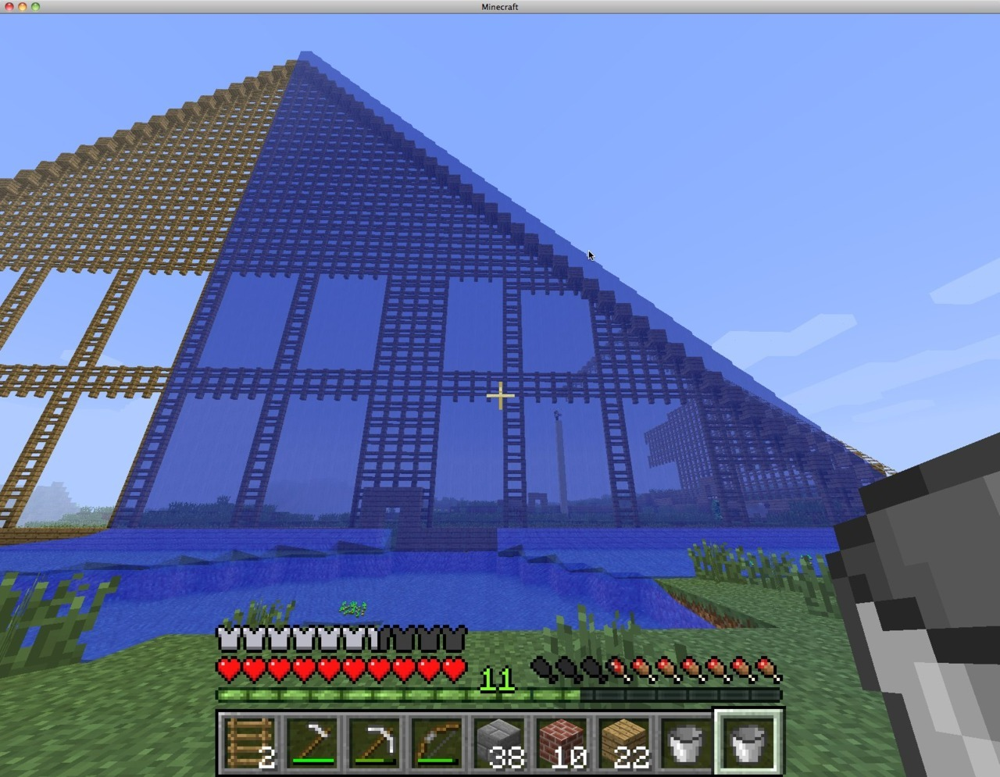

*Originally posted to [deafferret](https://deafferret.tumblr.com/post/15838261872/so-a-single-water-source-turns-an-entire-half-of) on 2012-01-14.*

So, a single water source turns an entire half of a roller coaster into a waterslide.  :)

Unfortunately, all the rails ceased to exist, which is a 1.1 bug IMHO.
