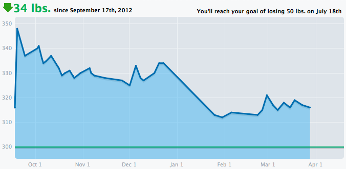

*Originally posted to [deafferret](https://deafferret.tumblr.com/post/46508102007/down-34-pounds-and-holding-since-i-started-the) on 2013-03-28.*

Down 34 pounds and holding since I started the Paleo / Primal “diet.” Eating as much as I want of the approved foods. Not hungry like I was for decades. Dropped 22 pounds through excessive walking around Asia for a month, followed by 2 weeks of vicious food poisoning. Paleo didn’t take that weight off, but I completely credit Paleo for keeping it off. I’m 100% sure that if I ate low fat + grains daily I’d be back to 360 pounds (45 higher) in no time. Very grateful to Paleo / Primal / [Mark Sisson](http://primalblueprint.com/products/The-Primal-Blueprint%3A-Updated-and-Expanded-%28Paperback-Edition%29.html) and friends.

It’d be nice to hit 300, but I don’t think food alone will do it – I probably need to crank up the exercise here at home for a while, then hopefully Paleo would help me keep it off, even as a dude who sits on his ass all day for a living. :)
