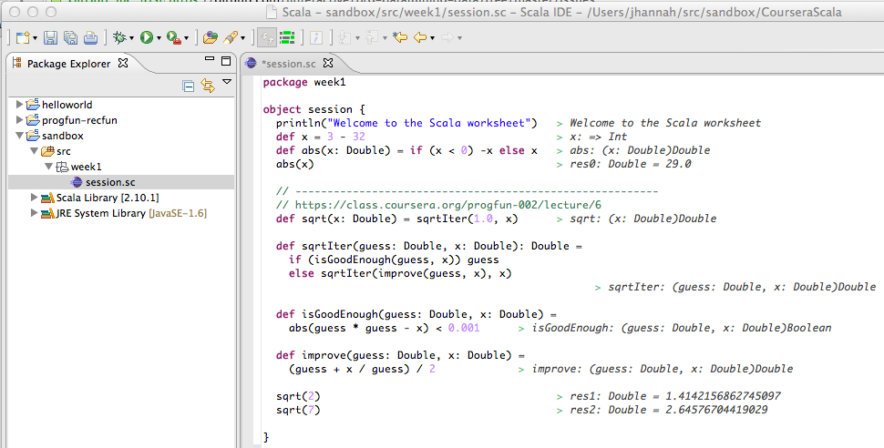

*Originally posted to [deafferret](https://deafferret.tumblr.com/post/46885980434/ok-i-usually-hate-ides-but-i-have-to-give-the) on 2013-04-01.*

OK, I usually hate IDEs. But I have to give the Scala IDE (Eclipse) credit: Scala Worksheets are pretty freaking awesome!

Infinite loops create a little ASCII swirly thing in the Worksheet. LOL
