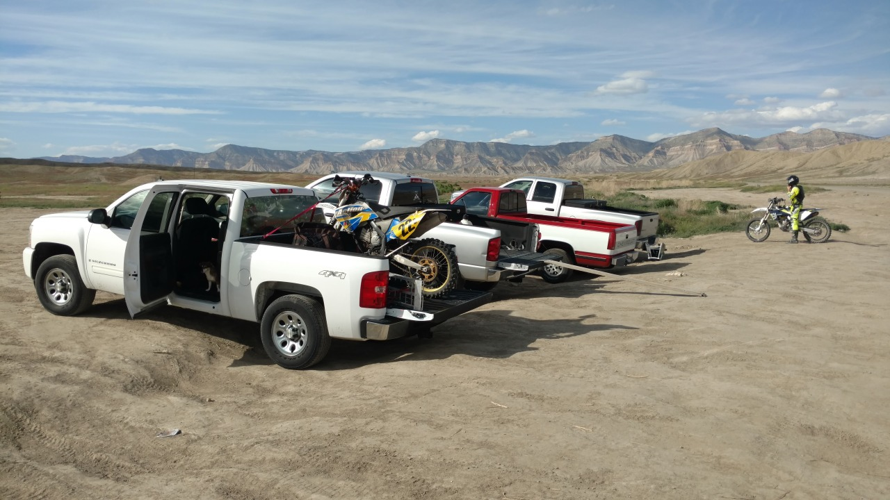
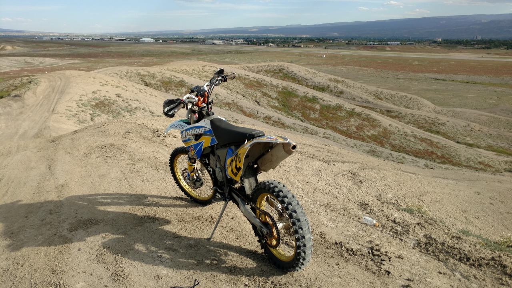
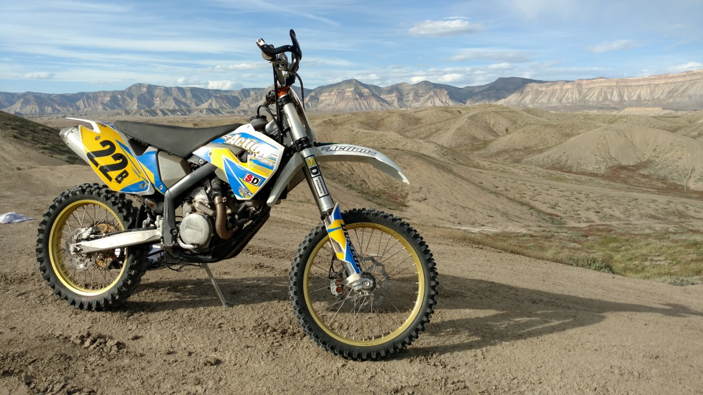

*Originally posted to [deafferret](https://deafferret.tumblr.com/post/144859890358/north-of-the-grand-junction-airport-you-can-see) on 2016-05-24.*

North of the Grand Junction airport (you can see the runway in the 2nd photo) you can ride off road vehicles through the desert FOREVER. All alone with purple brush, irrigation ditches, enormous prairie dog cities, jackrabbits scurrying everywhere, tiny red flowers blooming. Exciting hill climbs, scary ditches, gorgeous color banded rolling hills for endless miles… [Grand Valley Open OHV Area](https://goo.gl/oz09WR) is amazing when you’re used to 300 acres being a “big park” in Iowa.

I should have taken more photos, but I didn’t want to stop. Rode until a gorgeous sunset sent Minnie and I back to the RV for the night.
