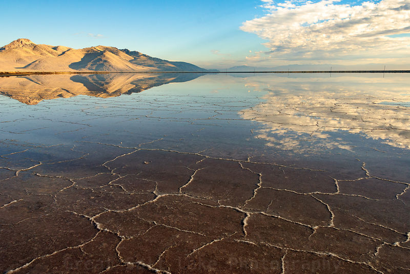

*Originally posted to [deafferret](https://deafferret.tumblr.com/post/145432786893/photo-credit-great-salt-lake-by-charles-uibel) on 2016-06-04.*

Photo credit: [Great Salt Lake by Charles Uibel](http://www.greatsaltlake.photography/-/galleries/cat/great-salt-lake/-/medias/678d9d6d-8b4e-45ef-b38a-7119de9f1e64-great-salt-lake-by-charles-uibel)

Minnie and I left Green River Utah this morning, through the sun-baked plateaus of striped browns and yellows. Last year I traveled this same highway 191, but south, through hours of pouring rain. The endless Utah desert wasn’t desert at all, it was marshland to the cliff horizons in every direction. I decided not to head down to Moab for dirt biking, since Iowa riding has trained me that rain means terrible, unrideably slippery mud. A week ago I was told that was a horrible mistake – in heavy rains the red rocks of Moab sprout hundreds of volunteer waterfalls that burst from cliffs everywhere. A rare opportunity, and I missed it.

In contrast, today’s trip north was, presumably, the normal summer Utah. Dead dry brown desert everywhere. Endless sun. No clouds. An amazing sight to my mid-western eyes. In places the highway stretches for miles, laser straight. Disappearing to the horizon over ridges that must have taken months to flatten to acceptable grades, decades ago. Triumphs of engineering over nature, traversed by millions of people blasting their air conditioners at 80 miles per hour.

Arrived in the greater Salt Lake City area, headed west on Interstate 80. The drive west of SLC is a surreal, alien experience. The Great Salt Lake is surrounded by countless acres of dry salt, cracked in the summer heat. The water becomes a perfect mirror in the distance, mountains appearing twice on the horizon. Hours across Utah surrounded by salt in every direction, until you finally reach the Bonneville Salt Flats International Speedway exit on the western edge. The gas station attendant said there was nothing to see on the Speedway until the motorized circus arrives in August, so I settled for a BLM sticker to slap on the RV.

Up the ridge into Nevada. A couple rounds of hill climbing in the slow lane, the landscape turning green. A color I haven’t seen much of for 2 weeks. It’s just scrub brush, but its green and everywhere. Bunked down in Wells Nevada overnight, heading to Oregon tomorrow.
