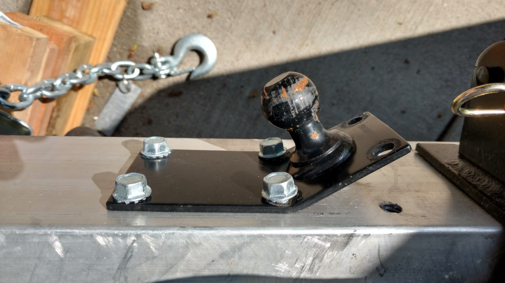

*Originally posted to [deafferret](https://deafferret.tumblr.com/post/144151980608/pro-tip-when-your-friction-sway-control-bar-is) on 2016-05-10.*

Pro tip: When your friction sway control bar is mounted, don’t pull too sharp to the left backing the trailer out of the farmhouse.
