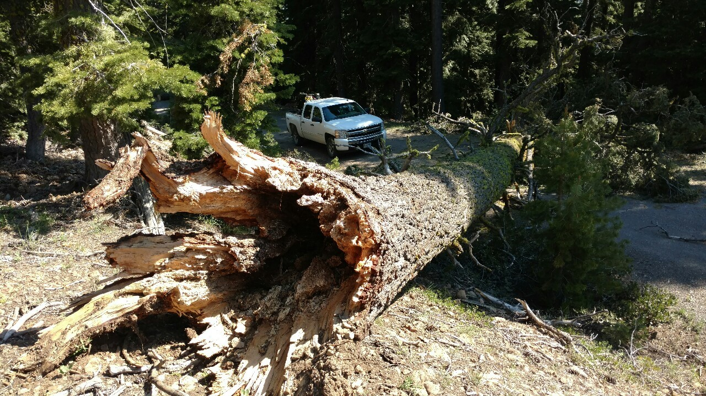
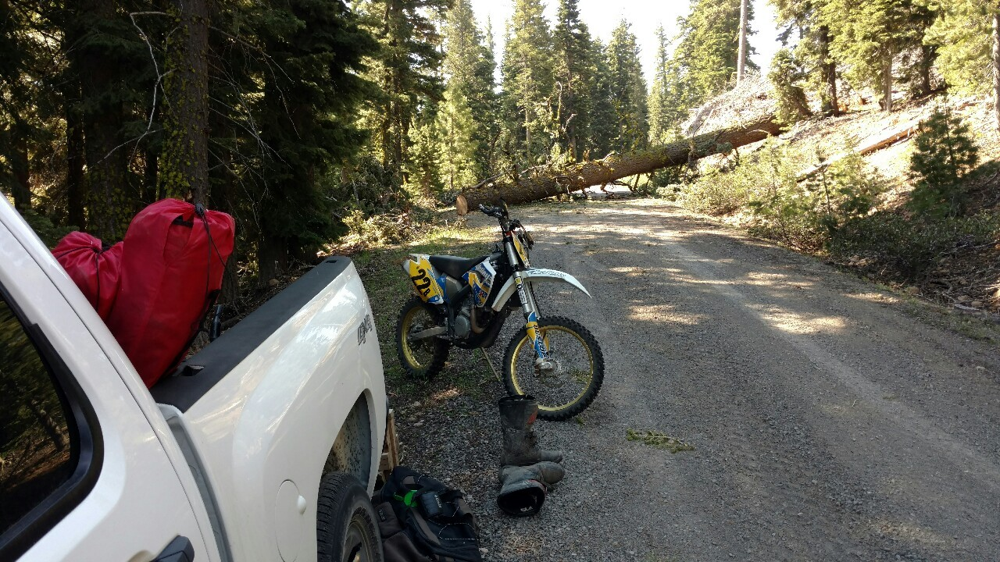
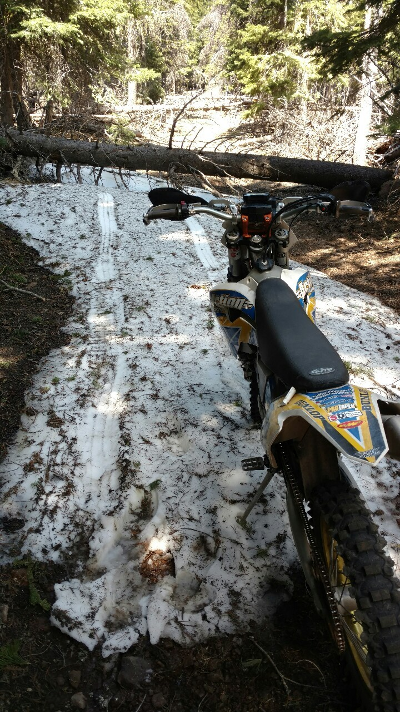

*Originally posted to [deafferret](https://deafferret.tumblr.com/post/145786514718/so-apparently-this-is-how-trailheads-work-in) on 2016-06-11.*

So apparently this is how trailheads work in Oregon. Drive towards the actual trailhead, see how far you get up the logging road before an enormous tree is blocking the entire road. Congrats, you’ve arrived at your completely unofficial trailhead.

You won’t get far up the official Willow Creek OHV Area trail before the whole thing is blocked by down trees & 4 foot snow drifts.

So ride around all the surrounding logging roads in total amazement of the lush greens and ponds surrounded by various colors of little flowers.
