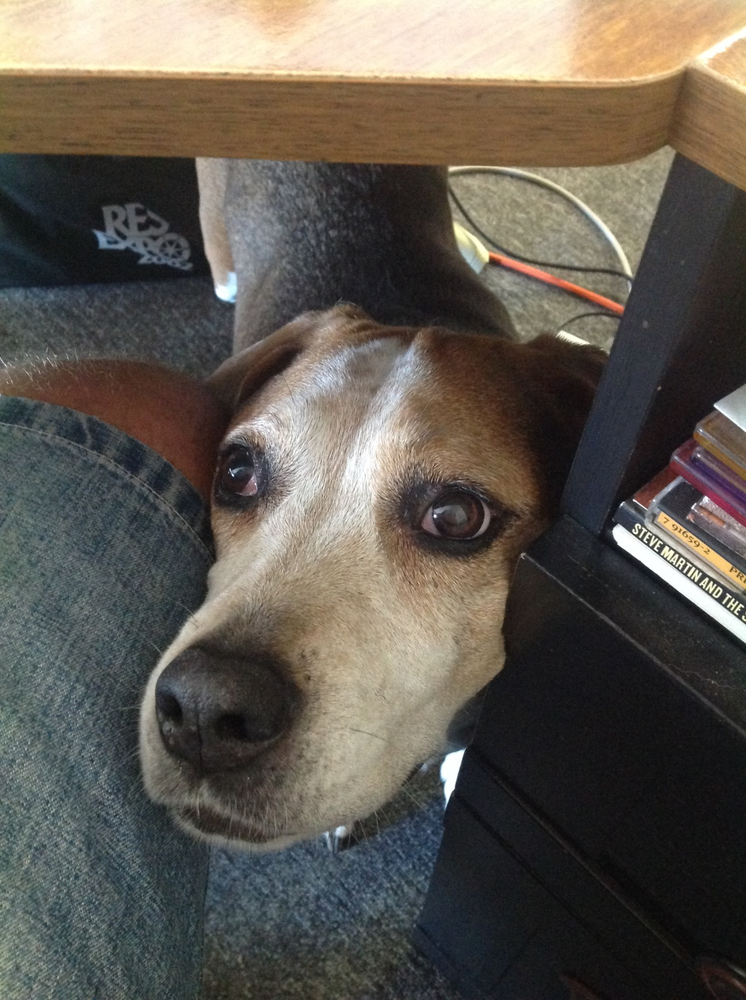

*Originally posted to [deafferret](https://deafferret.tumblr.com/post/137117943968/tipper-and-minnie-both-turn-13-this-year-this-is) on 2016-01-11.*

Tipper and Minnie both turn 13 this year. This is very old for Tipper. Minnie will probably be with us a few more years.

Minnie is currently doing great, having 100% recovered from her most recent episode.

A couple days ago Tipper started breathing twice as much as normal, even when resting. I took her to Dr. Morgan today.

Best case scenario, she’ll be on pills for 3 days which make her pee a lot, her lungs will clear, and she’ll be on a light dose of these pee-a-lot pills for the rest of her life.

Worst case scenario it’s cancer, and she might not be with us much longer. If at some point she can no longer breathe OK, eat enough, and move in and out of the basement doggy door it will be time for us to say goodbye.

I’ve set up home office / bedroom in the basement, as we have done in years past. Tipper is resting comfortably. She’s not in pain, she’s just breathing a lot more than normal because her lungs are not working as well as they should.

I’m hoping for a lot of peeing over the next 3 days, and that she bounces back, like she has so many times over the last 12 years. :)
