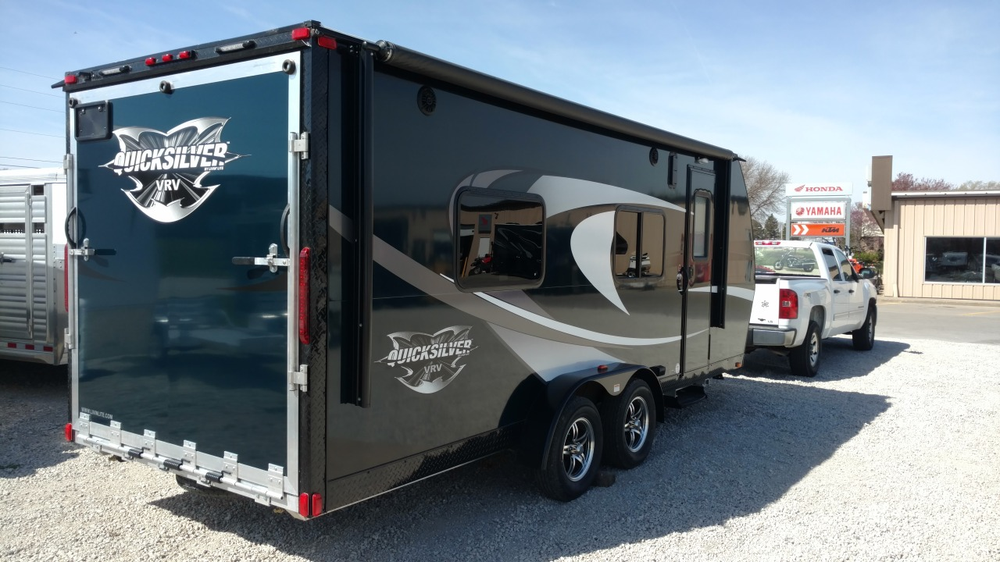
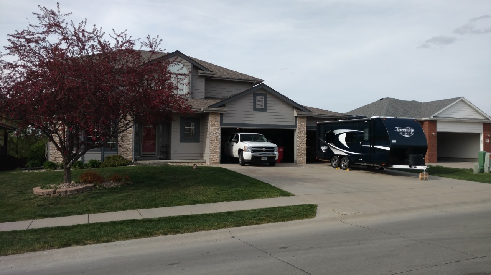
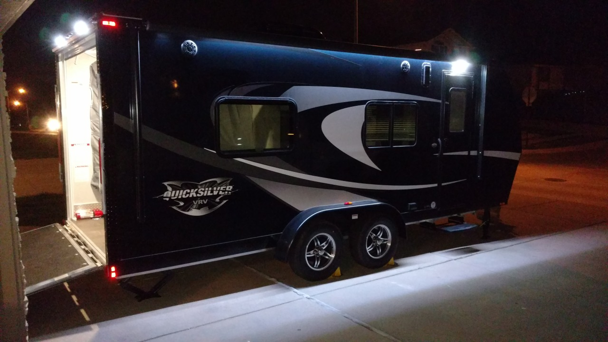
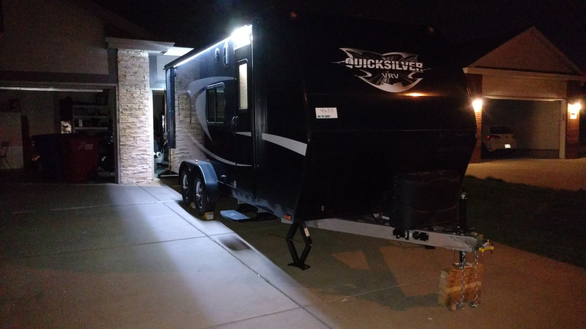
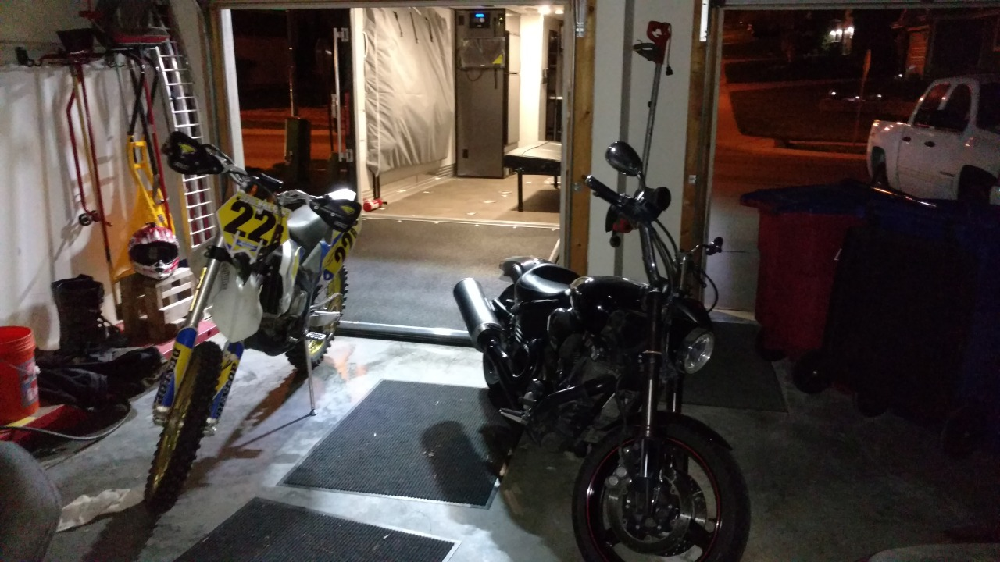
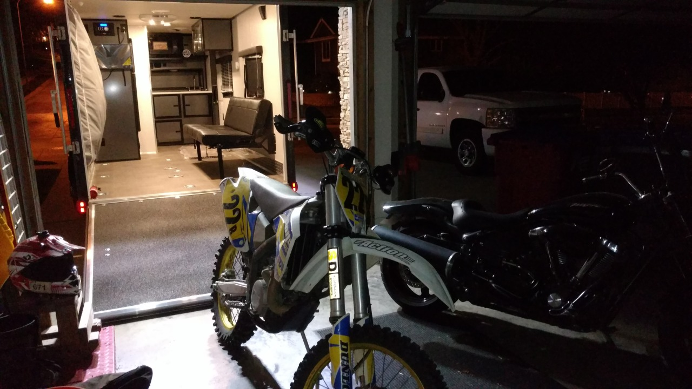
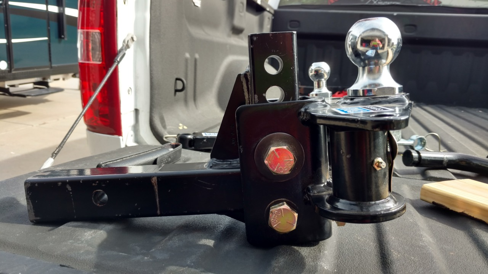

*Originally posted to [deafferret](https://deafferret.tumblr.com/post/142894029083/yay-my-new-home-is-finally-home-super-happy-with) on 2016-04-16.*

Yay! My new home is finally home. Super happy with the unit, already learned a ton about RVs. For example:

One does not simply awake at an ungodly hour, drive 90m, arrive when the dealership opens, allow 2 hours for inspection and pickup, and drive 90m home to be at work by noon. It takes all day to pick up a trailer. First, since you know nothing, they go through every feature of the toy hauler, which takes a LONG time, since you have no idea what you’re doing and it has a ton of features. Thank dog everything major seems like it’s what you ordered, and working great.

Then they up-sell you to a super fancy weight distributing interstate wind fighting friction sway bar tow hitch thing. By all accounts, this is an excellent idea, and you’re glad you bought it, but that takes 2 hours to install. (No problem, but not the original plan.)

Then you get it home and stare at it on flat concrete and realize that the trailer is “riding high.” Need to drop the ball hitch. A couple inches? OK, you’ll deal with that later.

Then you fret that you’re going to rip your poop tube tube (the tube your poop tube goes in) off on your curb / driveway. Thankfully it clears, and you owe your friendly neighbor spotter a beer.

Then you wheel chuck the trailer and jack it up higher and higher and higher and higher with more and more and more wood until you finally walk around the side of the truck and realize you’ve jacked your entire rear of your pickup into the air. Turns out there’s lots of different types of ball hitches and the type you had 20 years ago is not the type you own now. You have to *slide* the lever to release the ball, not just pull on it. Your reward for finally figuring that out is the 60lb super hitch ball thing tries really hard to smash your foot.

Then you stare at the super hitch ball thing and realize that while it is adjustable, you need the worlds biggest wrenches. And a vice. Oh, and they lock-tighted it, so you’re screwed anyway. Hopefully a local dealer can sort that tomorrow.

Then your neighbor shows you an awesome gadget where with a power drill you can lower your support legs in 3 seconds with zero effort. You need one of those!

Then you have lots of conversations about RPMs and speed limits and uphills and downhills and jack-knifing and trailer brake gain adjustments and HD tow packages on little trucks and transmission fluid coolant systems and spec sheets and YouTube videos you need to watch.

Then your neighbor points out that without the right locks its trivial to steal the whole thing and drive off in the middle of the night. Like, tonight for example. Run to Lowes and stare at their wall of locking options and hope the stuff you buy is what you need. Get home and discover that you were half right, and the trailer will probably still be sitting there in the morning now.

Your Fitbit is congratulating you – you’ve been running around all day! Should have worn your comfortable shoes, dummy.

Crawl into bed, exhausted. You learned stuff. Good job. :)
