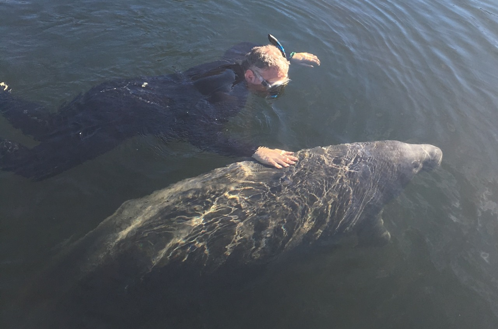
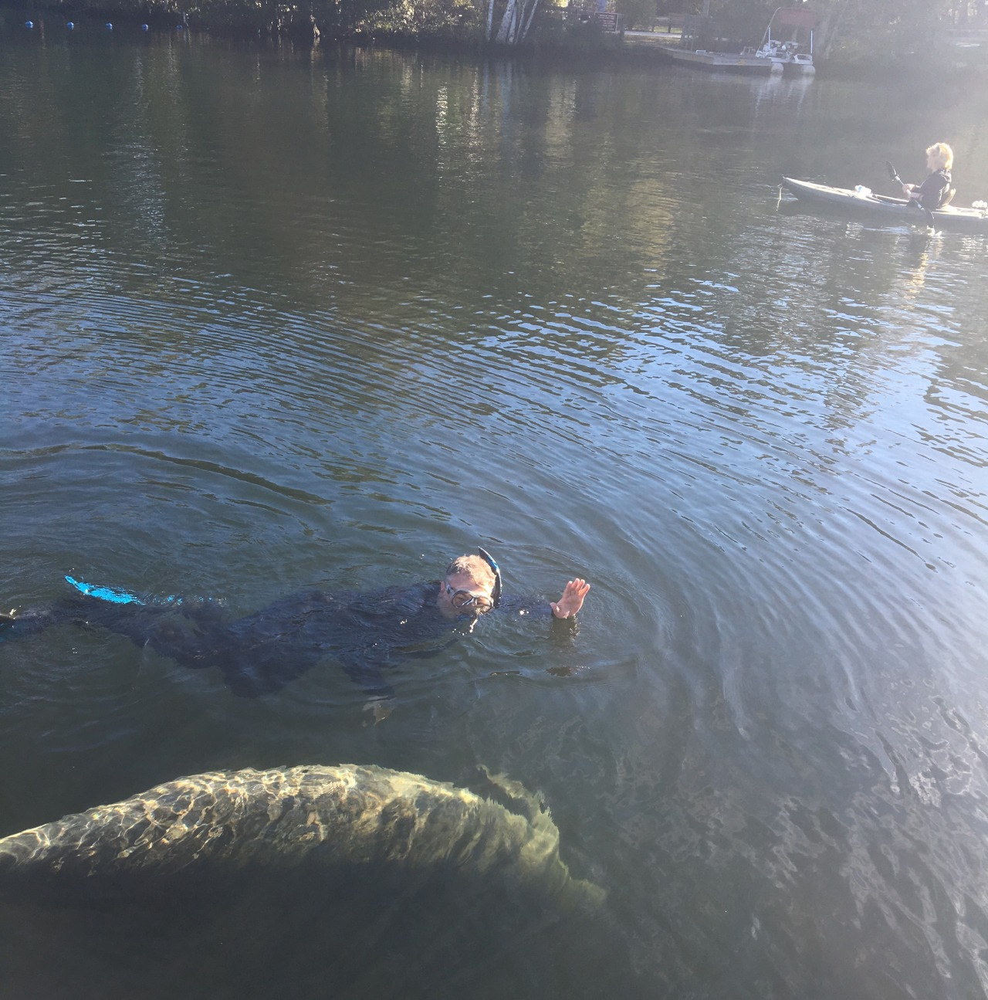
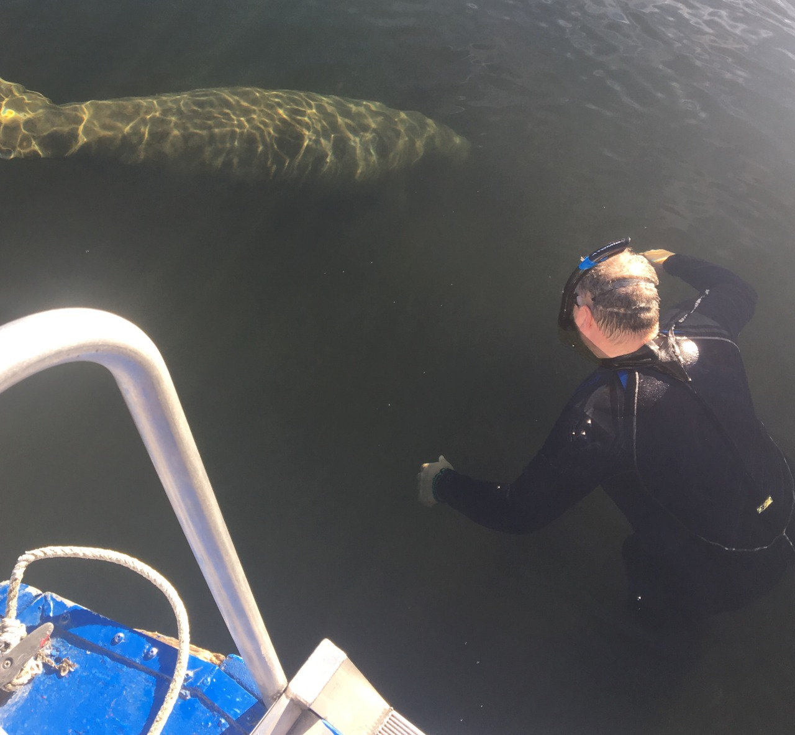

*Originally posted to [deafferret](https://deafferret.tumblr.com/post/156464797103/snorkeling-w-manatees-in-homosassa-fl-d) on 2017-01-27.*

Snorkeling w/ manatees in Homosassa, FL. :D

[http://manateetours.net/](http://manateetours.net/) Captain Don is the best.

There are 2 zones. In Homosassa it’s state run, you can pet them except on their heads. South of here there’s a federally run park where touching them is prohibited. Some of them don’t want anything to do with people. Some of them are curious then wander off. Some roll over because they love belly rubs. One of them grabbed me repeatedly, squeezing me with its flippers. They call that one “Ester the Molester.”
