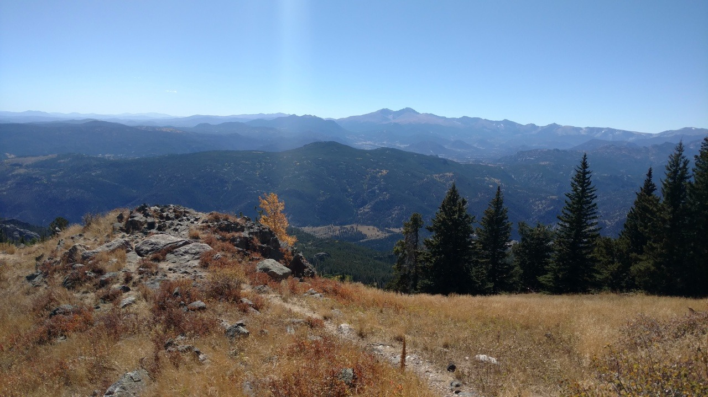
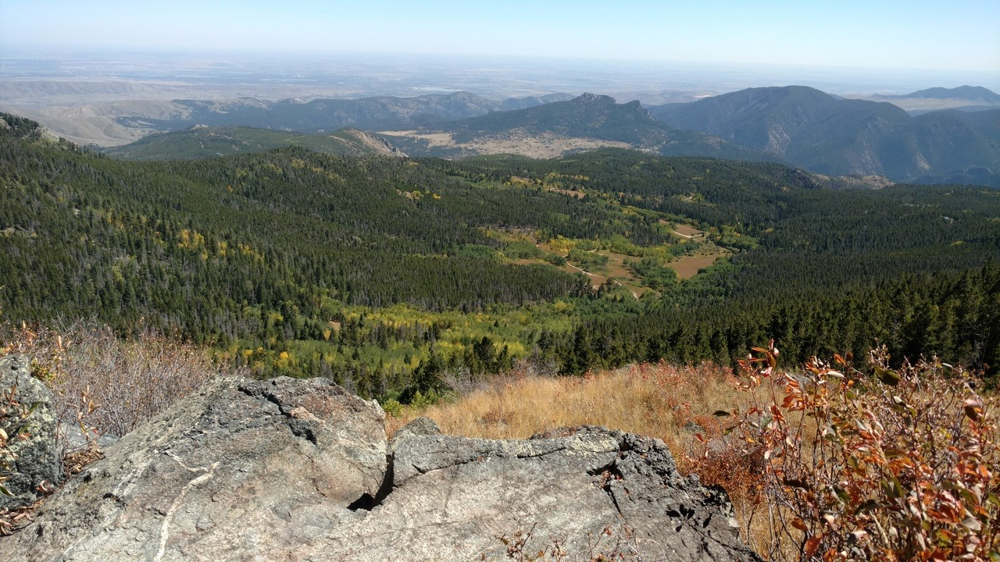
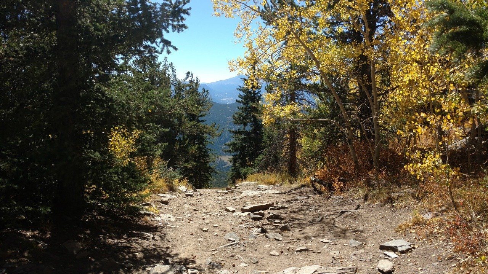
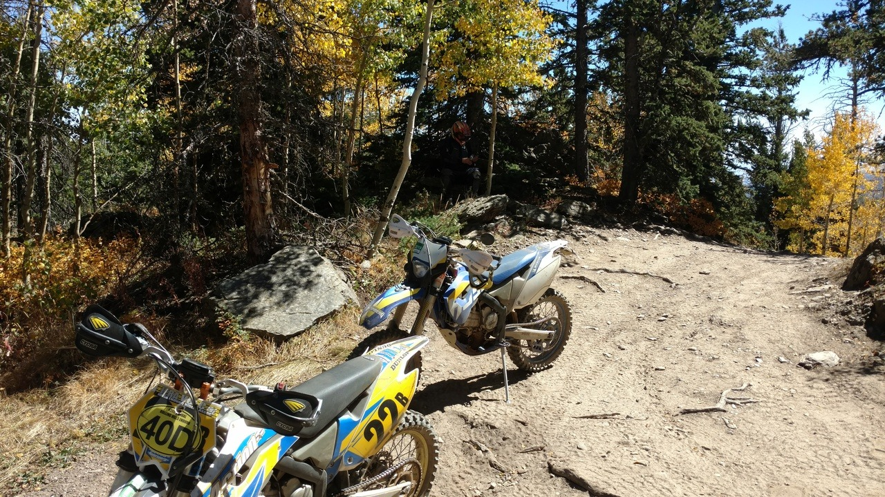
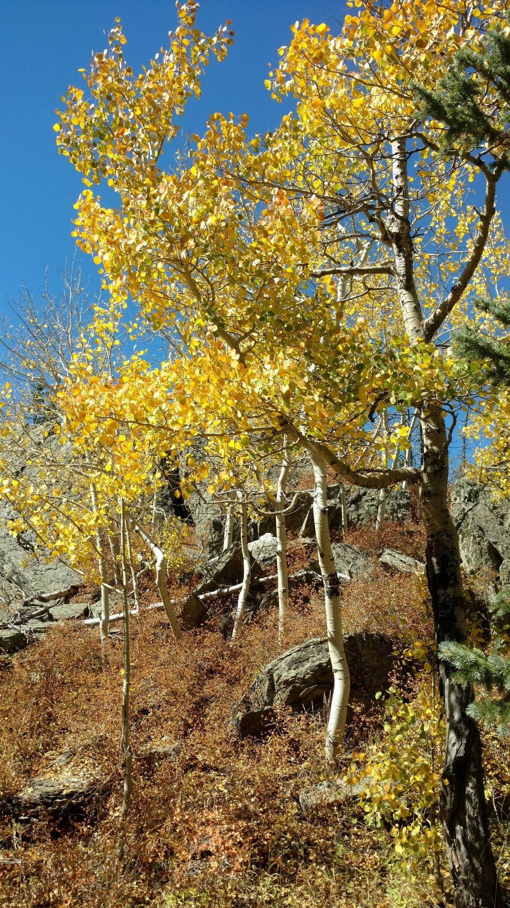

*Originally posted to [deafferret](https://deafferret.tumblr.com/post/178079256788/rving-for-a-week-in-loveland-colorado-summited) on 2018-09-14.*

RVing for a week in Loveland, Colorado. Summited Storm Mountain NW of Drake CO, and rode SE and above Estes Park CO with Chris Nelson. Many aspens turning gold for the fall. :)

Toilet value is slow dripping, because its not an RV trip without some new mechanical flaw springing out of nowhere. :/
