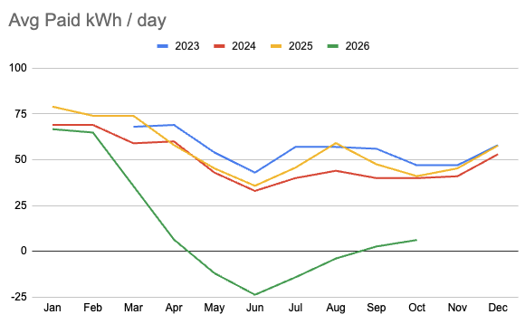
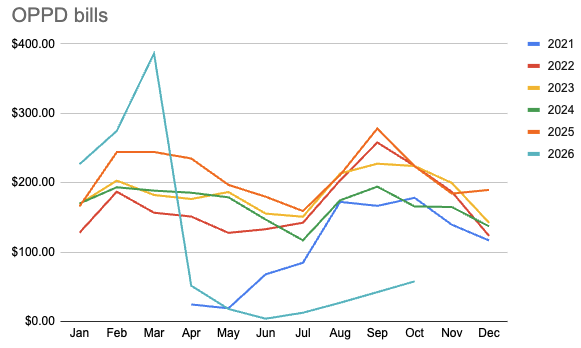

81 MW: Just west of Omaha:
[Platteview Solar Project](https://www.aes.com/energy-projects/platteview-solar-project-aes)

5 MW: Just north of my house,
[east of Fort Calhoun](https://pubdisplay.alsoenergy.com/kiosk/18014398509527082?dashkey=2a5669734965576e4a43513d3d&tag=4246267#xd_co_f=ODUyYTZmYzctNDcxNS00OGY5LTlmNjEtM2RlMWM1ODAyNGQz~)

12.6 kW: My house, theoretical max:
* 20 panels "south-facing"
* 12 panels "east-facing"

System installed late 2025.
Finally activated by OPPD Feb 12 2026.

Solar system designed, installed by: [New Energy, LLC](https://newenergyne.com).
They also replaced my roof and my electrical mains, installed a whole-house generator plug
on the outer wall, and ran a line for a future electric vehicle in our garage. 🤑

Dates:

* 2023-07-27: Solar Shield window tint installed
* 2023-09-27: modern attic insulation installed
* 2026-02-12: solar panels came online

## 20-year savings estimate

(Extrapolated by claude-opus-5-5, October 2026.)

Apr–Oct bills: $1,483.65 in 2025 vs. $213.03 in 2026. **$1,270.62 saved (86%)**.
June–August bills nearly vanished ($3.96, $12.58, $26.92).

No full winter with solar yet. The Feb/Mar 2026 bills ($274.60, $386.29) mostly cover
usage from before activation. Assuming ~45% savings Nov–Mar (half the winter sun, higher
usage) adds ~$500, so **year-one savings ≈ $1,750**.

Savings ≈ kWh produced × OPPD's rate, so the two big variables are rate increases and
panel degradation (~0.5%/yr):

| Scenario | 20-year savings |
|---|---|
| No rate increases, 0.5%/yr degradation | ~$33,000 |
| Flat (no increases, no degradation) | ~$35,000 |
| **3%/yr rate increases, 0.5%/yr degradation** | **~$44,500** |
| 4%/yr rate increases, 0.5%/yr degradation | ~$49,000 |

Caveats:
* Winter is the big unknown. 25% or 65% winter savings instead of 45% swings the total ±$5,000.
* Growing usage (2025 was ~20% above 2024) mostly adds to what I pay, not to what I save,
  unless I start using more of what I currently export (hello, future EV).
* OPPD net-metering / export-credit policy could change.
* Not included: inverter replacement (~$1,500–3,000 around year 10–15), time value of money,
  tax credits, or system cost.

